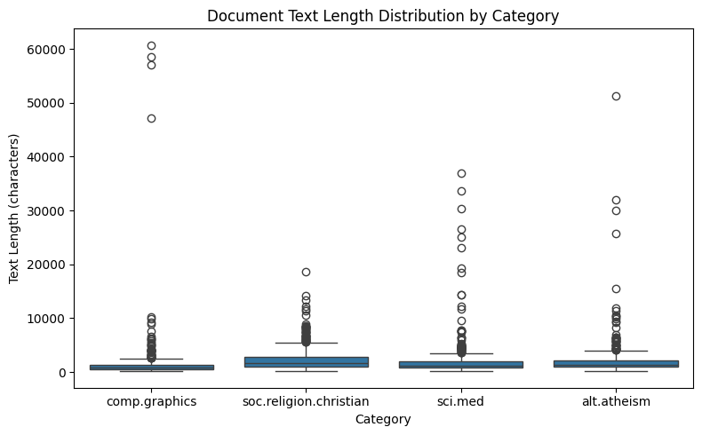
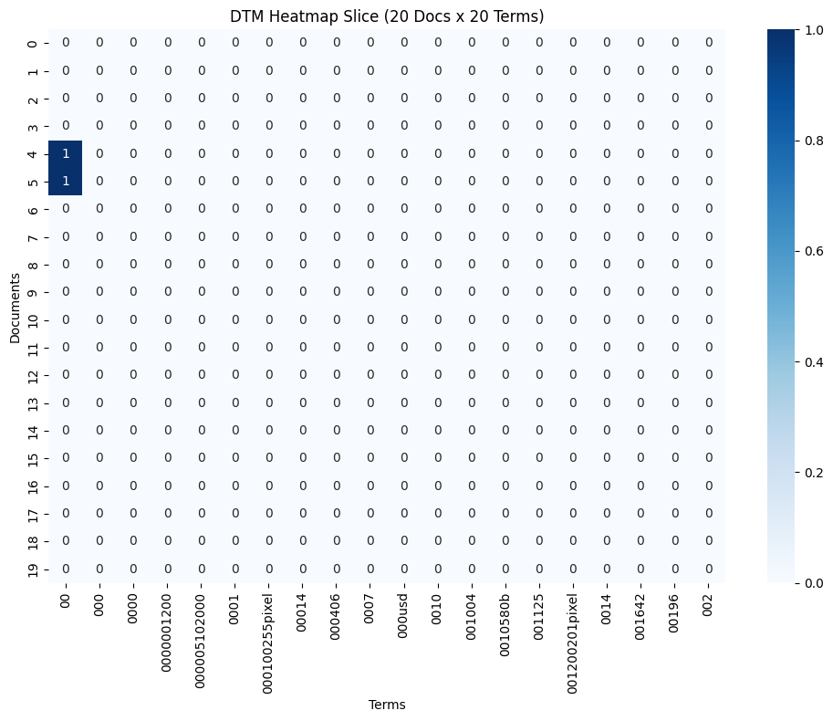
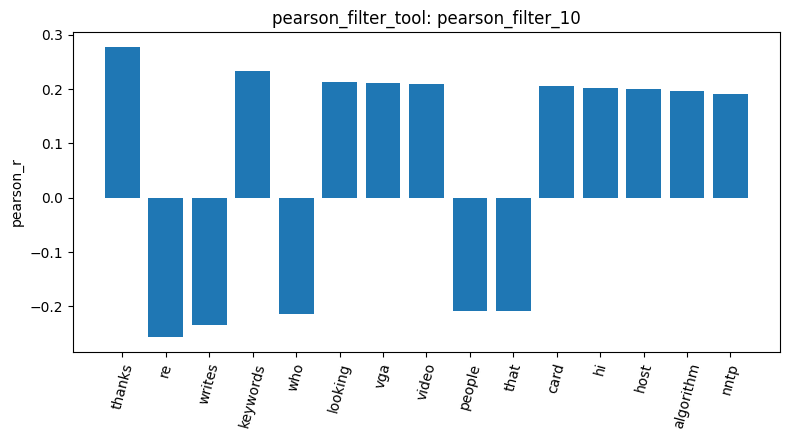
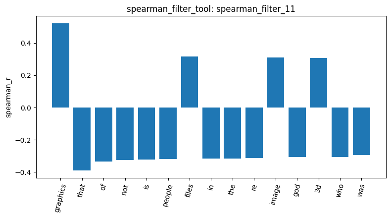
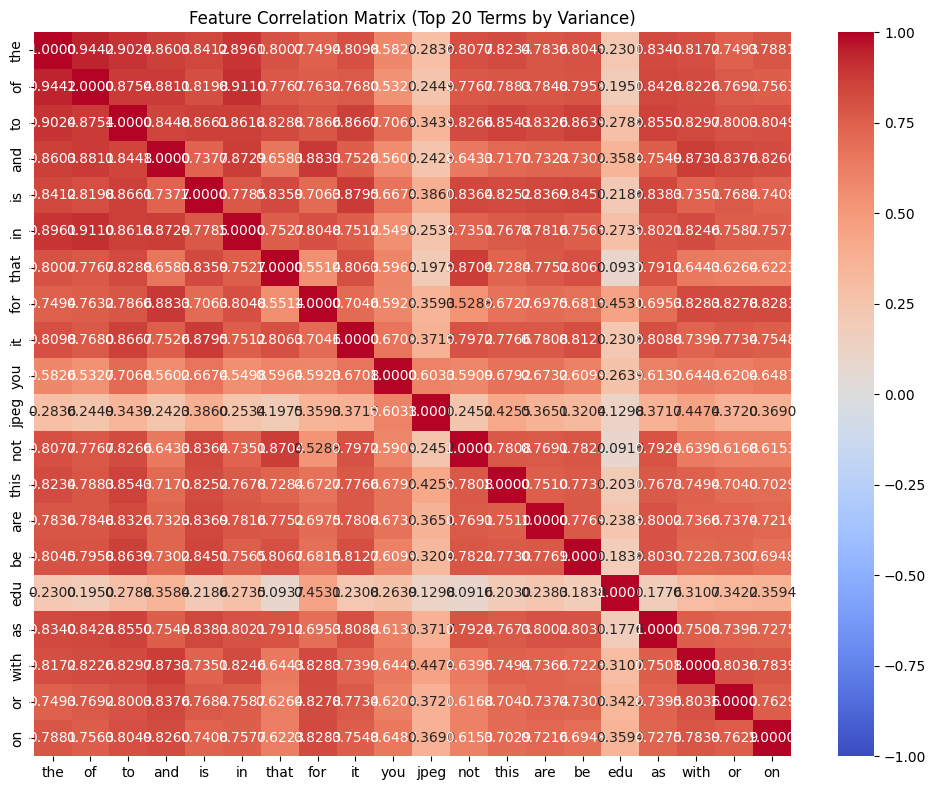
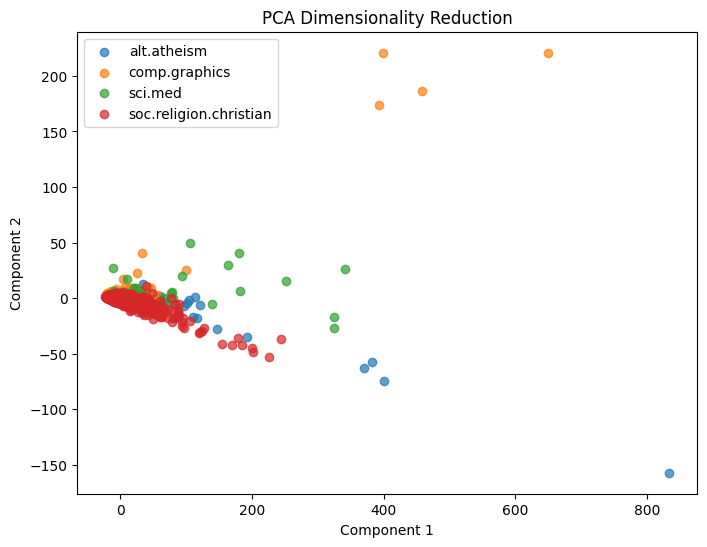
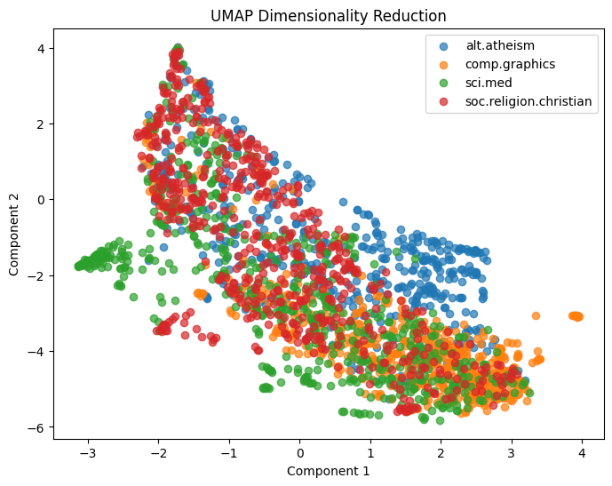

# Agentic Pipeline: Experiment Notes

林芷瀅 | 113034038

For this experiment, I asked an agent to use the tools I had written to analyze posts from four discussion groups: computer graphics, medicine, Christianity, and atheism. I wanted to see which words could help distinguish the topics, and whether document length, headers, and reply formatting would affect the results.

The sections follow the notebook's workflow. Step numbers refer to the course sequence, while each `result_id` identifies a particular tool output.

## Dataset Overview (Steps 1–5)

result_id: `load_dataset_1`, `inspect_data_2`, `check_missing_3`, `check_duplicates_4`

| Category | Topic | Documents |
| --- | --- | ---: |
| soc.religion.christian | Christianity | 599 |
| sci.med | Medicine | 594 |
| comp.graphics | Computer graphics | 584 |
| alt.atheism | Atheism | 480 |
| **Total** | | **2,257** |

I use christian, graphics, and atheism as shorter names below. Atheism has fewer posts than the other groups, so I need to account for that when comparing word totals.

The original posts include headers such as From, Subject, and Organization, which also become terms in the analysis. Both the missing-text check and the duplicate check returned 0, so no documents were removed. The dataset still contains 2,257 posts.

result_id: `describe_data_5`

Length is measured in **characters**. The median is **883** for graphics and **1,649** for christian, almost twice as long. Yet the longest document belongs to graphics, at **60,713** characters.

So graphics has the shortest median of these two categories, but also the longest individual post. I wanted to keep both in mind when looking at word counts. The agent suggested that the long post might contain code or an encoded image; I had not checked its text, so that was still a guess.

## Term Frequency and Feature Selection (Steps 6–13)

### Common words and formatting are still in the raw counts

result_id: `build_dtm_6`, `term_frequency_7`, `dtm_heatmap_8`

In the document-term matrix (DTM), each row is a document, each column is a term, and each cell holds its count. This run kept all **2,257 documents and 35,788 terms**, with **365,886** nonzero entries and about **99.547%** sparsity. Each document uses only a small part of the full vocabulary, so most cells are 0.

Here are the five most frequent terms, plus two others worth noticing:

| Rank | Term | Total count |
| ---: | --- | ---: |
| 1 | the | 29,825 |
| 2 | of | 17,660 |
| 3 | to | 17,222 |
| 4 | and | 13,017 |
| 5 | is | 12,343 |
| 14 | from | 4,877 |
| 16 | edu | 4,675 |

The first five terms tell me little about the four topics. `from` and `edu` are more interesting here: they may come from headers, email addresses, or domain names. The counts include all of that material along with the actual discussion.

This heatmap takes the first 20 documents and terms in their existing order. The odd-looking terms, including `000100255pixel` and `001200201pixel`, are therefore not the most frequent words. They look like technical strings, but I have not traced them to their source posts or to the unusually long graphics document.

### Why did the variance filter keep `the`?

result_id: `variance_filter_9`

With a threshold of **0.01**, the tool listed **5,354** of the 35,788 terms to keep and **30,434** to remove.

The agent had suggested that variance filtering could handle stopwords, so I checked `the`, `of`, and `to`. All three remained. That was a problem with its explanation: a word like `the` can appear a few times in a short post and many times in a long one, giving it plenty of variance. The filter has no rule saying that common English words should go.

This tool **only reports the lists; it does not modify the DTM**. Later steps still use the original matrix.

### Why did `thanks` rank above `graphics`?

result_id: `pearson_filter_10`, `spearman_filter_11`

Both runs compare graphics against the other three categories. Positive coefficients indicate an association with graphics, while negative ones indicate an association with the other categories. Terms are ranked by the absolute value of their correlation coefficient.

| Pearson | Spearman |
| --- | --- |
|  |  |

| Comparison | Pearson | Spearman |
| --- | --- | --- |
| Top term | thanks (+0.2778) | graphics (+0.5211) |
| Position of graphics | Not among the 15 terms shown | Rank 1 |
| Coefficient range shown | About −0.26 to +0.28 | About −0.39 to +0.52 |
| Examples of positive correlations | thanks, keywords, looking, vga, video | graphics, files, image, 3d |
| Examples of negative correlations | re, writes, who, people, that | that, of, not, is, the, re, god |

I expected `graphics` or a technical term to come first. Instead, Pearson gave me `thanks`. The agent suggested that graphics posts might often be requests for help ending with thanks. That sounds plausible, and it would explain why a polite closing could rank above the topic itself, but I would need to read the posts to check. Its explanation of `keywords` as language used when asking questions was less convincing to me: the word could also come from a `Keywords:` header.

Then the agent said `graphics` was in Pearson's top 15. I checked the chart: positions 11 through 15 were **card, hi, host, algorithm, and nntp**. It had mixed up the two results. I used the charts to correct the comparison table rather than carry that mistake into the interpretation.

Spearman's list was closer to what I expected: `graphics`, `files`, `image`, and `3d` were near the top. Ranking the counts reduces the influence of large count differences, which may help explain the change. I did not rerun the analysis without the longest post, though, so I cannot single it out as the reason. The methods may also have considered different vocabularies: Pearson evaluates every term, while Spearman defaults to the 1,500 highest-variance terms. My notes do not record this run's `max_terms` setting.

result_id: `feature_correlation_12`

In Spearman's results, `the`, `of`, `in`, and `is` were negatively correlated with graphics. I suspected this might be related to graphics posts usually being shorter. In this heatmap, `the`, `of`, `to`, `and`, `in`, and `is` are strongly positively correlated with one another, while `jpeg` and `edu` have weaker correlations with them. This fits the idea that several common words increase together as documents get longer.

The agent later called this "proven," which went further than I was willing to go. I reminded it that length was not even a variable in this heatmap. The common words do rise together, but I still need a direct comparison with document length to check my explanation.

## Pattern Mining (Step 14)

result_id: `mine_patterns_13`, `mine_patterns_14`, `mine_patterns_15`

This step looks for words that often appear in the same document, without requiring them to be adjacent or in a fixed order. The tool builds a separate DTM for each category, removes English stopwords, and uses TF-IDF to select terms. Support is the number of documents containing the whole group of words.

| result_id | Category | Settings | Patterns |
| --- | --- | --- | ---: |
| `mine_patterns_13` | comp.graphics | tfidf + fpgrowth, min_sup = 60 | 2,107 |
| `mine_patterns_14` | comp.graphics | tfidf + maxfpgrowth, min_sup = 60 | 98 |
| `mine_patterns_15` | soc.religion.christian | tfidf + maxfpgrowth, min_sup = 60 | 1,397 |

FPGrowth's top 10 patterns were still different combinations of `lines`, `subject`, `organization`, and `edu`. Both `lines` and `subject` had a support of **584**, equal to the total number of graphics documents.

I asked why headers still ranked highest after TF-IDF filtering. The agent blamed a low min_sup, but that did not explain `lines` and `subject` appearing in all 584 graphics posts. I pointed out that removing low-support patterns would still leave these very frequent headers.

The code gave me a more useful answer. Here, TF-IDF keeps terms whose mean scores are at or above the 20th percentile. There is no separate rule for removing headers, so they can survive this selection and enter the patterns.

Switching to MaxFPGrowth reduced the graphics result from **2,107 patterns to 98**. It keeps only frequent groups that cannot be extended into larger frequent groups, so I no longer had to look through so many subsets of the same combinations. Some topic words were easier to notice:

| Category | Some words found in the patterns |
| --- | --- |
| comp.graphics | image, file, files, software, version |
| soc.religion.christian | god, christ, jesus, people, think |

I could now see words such as `image` and `software` for graphics, and `god` and `jesus` for christian, although `lines subject organization` still appeared in many patterns. The topic words also fit the earlier correlations: `image` was positively correlated with graphics, while `god` was negatively correlated. MaxFPGrowth made the list easier to read; the header problem was still there.

One difference I still cannot fully explain is the pattern count: christian produced about **14 times** as many MaxFPGrowth patterns as graphics, even though min_sup was about 10% of the documents in each group. The longer christian posts give me one possible explanation, since they may contain more distinct words or quotations. I would need to inspect the recurring combinations to see whether that accounts for the gap.

## Dimensionality Reduction and Similarity (Steps 15–17)

### Can the plots separate the four categories?

PCA and UMAP both reduce the raw word counts to two dimensions. Each point is a document, and its color shows the category. Neither the variance filter's lists nor the TF-IDF filtering used in pattern mining changed this global DTM.

result_id: `reduce_dimensions_16`

PC1 explains **65.94%** of the variance and PC2 explains **4.33%**, for a total of **70.27%**. Most points are still packed near the origin, with heavy overlap between the four categories. A few outliers from atheism, graphics, and sci.med stretch the plot's scale.

The 70.27% sounds promising, but the plot still does little to separate the topics. PCA chooses directions that preserve variation in the counts without using the category labels. I suspect length or repeated words may account for some of that variation; checking the component weights and the outlying posts would help me find out what PC1 is picking up.

result_id: `reduce_dimensions_17`

UMAP used `n_neighbors=15` and `random_state=42`.

UMAP forms a band from the upper left to the lower right. There are more christian posts toward the upper left and more graphics posts toward the lower right, but substantial overlap remains. Atheism is more concentrated around the middle right, while sci.med has a small cluster on the left.

I can see more local structure here than in PCA, especially the small sci.med group. I have not checked whether those posts share content or just formatting, and I did not measure clustering quality. The code also uses the default **Euclidean distance** on raw counts, so count size can still affect which posts are treated as neighbors. The axes themselves do not tell me document length.

### The agent had a point about my one-hot counterexample

result_id: `binarize_labels_18`

One-hot encoding gives each category a column: 1 if the document belongs to it, and 0 otherwise. The output shape is **[2257, 4]**, and the column totals are **480, 584, 594, and 599**, matching the dataset overview. These are three rows from the first ten returned:

| Document index | alt.atheism | comp.graphics | sci.med | soc.religion.christian |
| ---: | ---: | ---: | ---: | ---: |
| 0 | 0 | 1 | 0 | 0 |
| 2 | 0 | 0 | 0 | 1 |
| 7 | 0 | 0 | 1 | 0 |

The agent used the total of 2,257 ones to argue that every row had one 1. I asked: what if one row had two ones and another had none? The total would still be the same. It then suggested looking at how `pd.get_dummies` works.

That suggestion changed my answer. The input is a single category column, so `pd.get_dummies` gives **at most one 1 per row**. My hypothetical row with two ones could not occur here. With exactly 2,257 ones across 2,257 rows, the total was enough to finish the argument: every row had one 1.

I still disagreed with its use of check_missing to rule out all-zero rows. Before encoding, the tool applies `pd.Categorical`; a label outside `session.categories` becomes NaN and can produce an all-zero row. Checking the original text for missing values would not catch that. What settled this case was the encoding behavior together with the returned totals.

### Cosine similarity: a smaller gap than I expected

result_id: `cosine_19`, `cosine_20`

Cosine similarity compares the direction of word-count vectors. A score closer to 1 means the word proportions are more alike. I expected posts in the same category to be more similar, but I also wondered whether shared stopwords and headers would reduce the gap between categories. I first compared two posts in the same category, then kept document 0 and compared it with a post from another category.

| result_id | Document pair | Categories | Cosine similarity |
| --- | --- | --- | ---: |
| `cosine_19` | 0 and 1 | comp.graphics / comp.graphics | 0.3532 |
| `cosine_20` | 0 and 2 | comp.graphics / soc.religion.christian | 0.3399 |

The same-category pair scored higher, as I expected, but only by **0.0133**. The graphics/christian pair was almost as similar. The agent blamed headers and stopwords, which would fit what I had seen earlier. This run did not break down the scores by word or compare cleaned texts, though, so I do not yet know how much they contributed.

The agent also proposed a "0.20–0.40 similarity baseline," but provided no data for that range. I only have two pairs, both involving document 0. I would want more pairs before deciding what counts as a high or low score in this dataset.

The agent did help clarify my question about length. Cosine divides by the vector lengths: doubling every word count leaves the score unchanged. Adding a quotation is different, because it can change the proportions of the words. That helped me distinguish a longer version of the same text from a longer post containing additional material.

## Conclusion

The result that stayed with me was `lines` and `subject` appearing in all **584 graphics posts**. I had asked why TF-IDF filtering still left headers at the top, and the agent's suggestion to raise min_sup did not address that. Switching to MaxFPGrowth cut the pattern list from 2,107 to 98 and made it easier to read, but the headers were still there. I would remove them explicitly before spending more time adjusting the mining settings.

I did find recognizable topic differences: Spearman put `graphics` first, and the pattern lists included `image` and `software` for graphics, versus `god` and `jesus` for christian. But Pearson's first-place `thanks` was a useful surprise. It made me consider whether the way people ask for help could be associated with a group, alongside the subject they discuss. I still need to read those posts to check that explanation.

The one-hot discussion was also worth keeping because I had to revise my own argument. My two-ones/zero-ones counterexample sounded reasonable until I checked what `pd.get_dummies` could actually produce. In other places, I had to correct the agent, including its claim that `graphics` appeared in Pearson's top 15. Going back to the code or chart was what resolved these disagreements.

Next, I would remove headers and compare the two cosine pairs again. The original gap was only **0.0133**, so I want to see whether cleaning changes it. I would then try more pairs before saying anything broader about similarity within and between the four groups.

---

[Analysis notebook](../DM2026-Lab1-AgenticPipeline.ipynb) · [Filtering and correlation tools](../agent_dev_workspace/tools_filtering.py) · [Pattern mining tool](../agent_dev_workspace/tools_patterns.py) · [Reduction and one-hot tools](../agent_dev_workspace/tools_reduction.py) · [Similarity tools](../agent_dev_workspace/tools_exploration.py)

