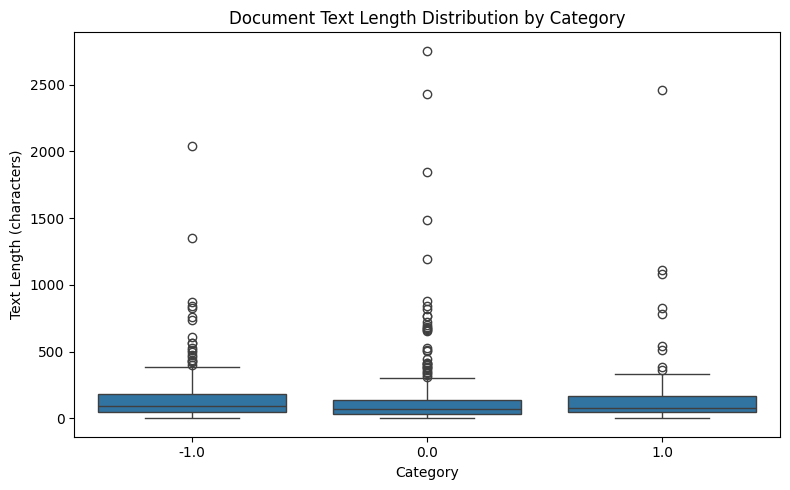
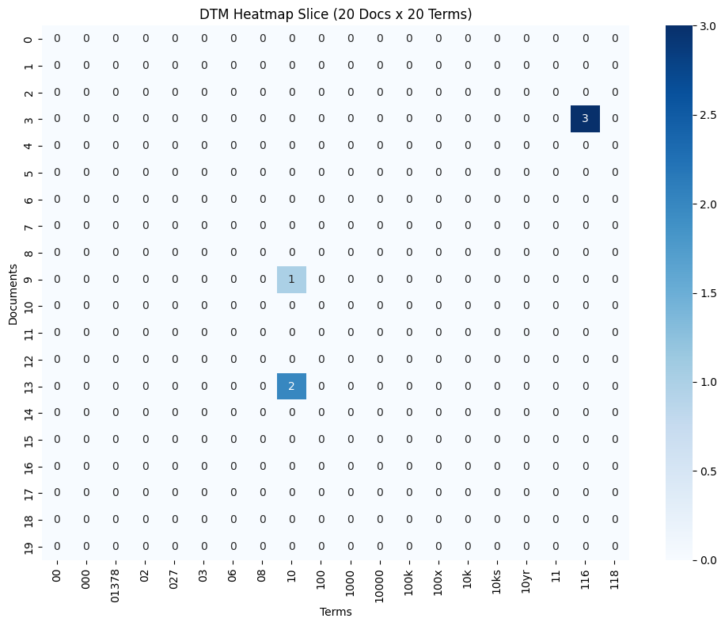
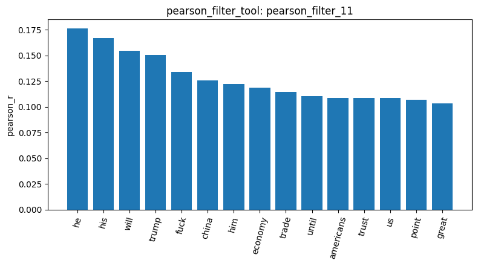
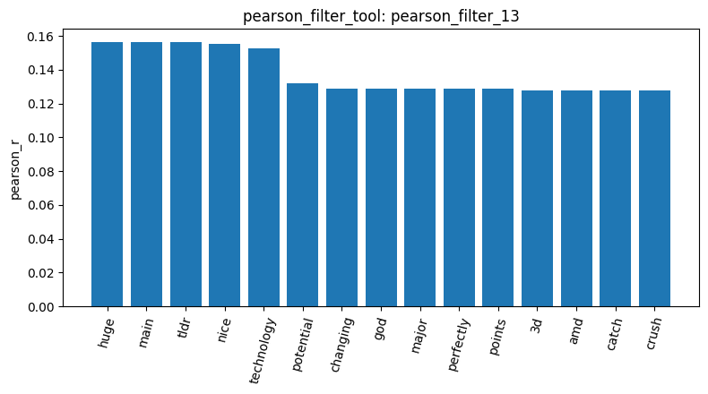
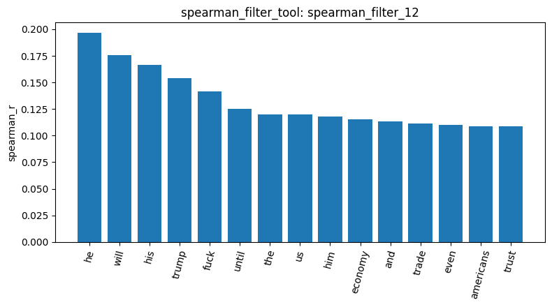
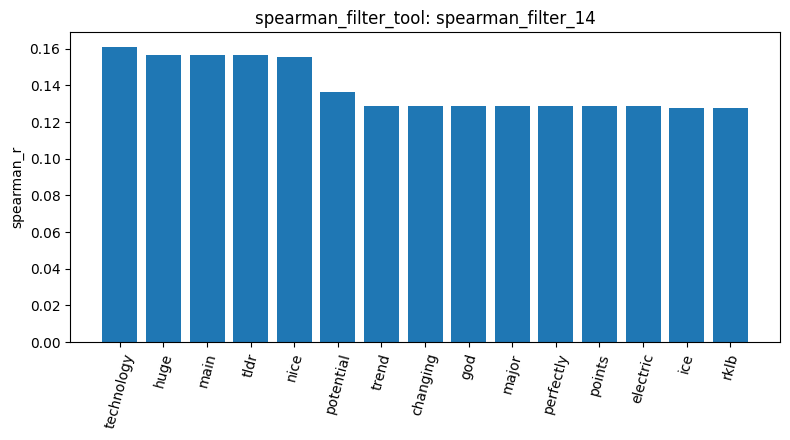
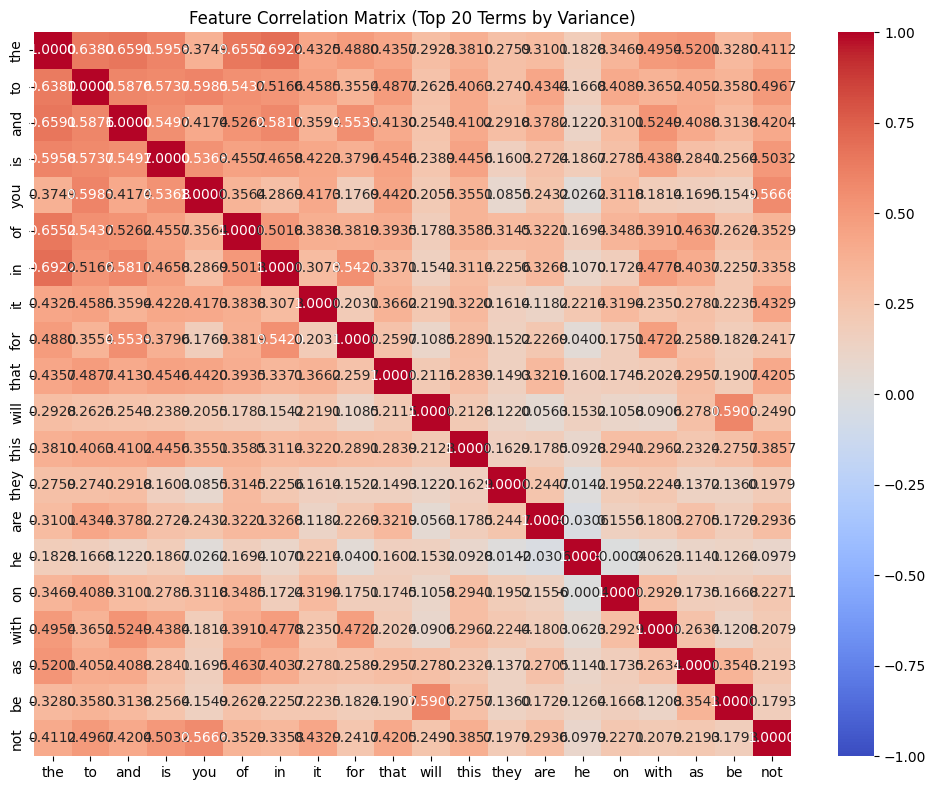
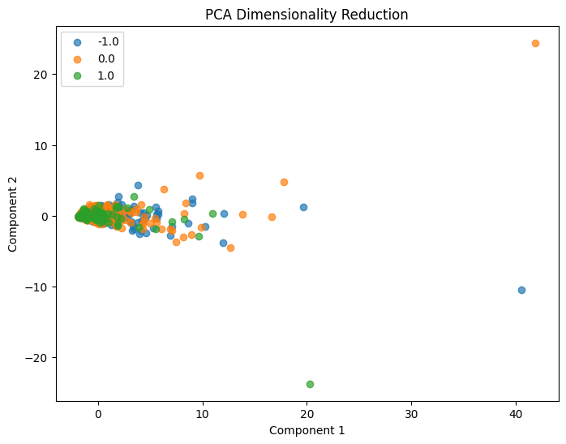
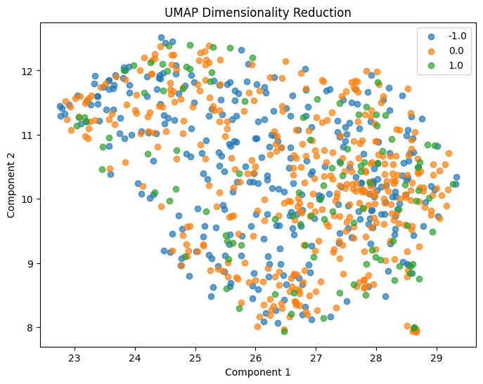

# Reddit Stock Sentiment: What Are the Words Actually Telling Me?

林芷瀅 | 113034038

For this homework, I used the same tools as in the agentic-pipeline experiment to analyze Reddit posts and comments about stocks. This time, the labels describe sentiment: negative, neutral, and positive. I wanted to see whether word counts would pick up people's attitudes, or mostly reflect what they were discussing.

The sections follow the course's pipeline sequence. Each `result_id` refers to a recorded tool result. Calculations added while checking this report are marked as **additional CSV checks**, separate from the original session results.

## Dataset Overview (Steps 1–5)

result_id: `load_dataset_1`, `inspect_data_2`, `check_missing_3`, `check_duplicates_4`, `check_duplicates_5`

I loaded [Reddit-stock-sentiment.csv](../newdataset/Reddit-stock-sentiment.csv), using `text` as the document and `label` as the sentiment category. The loader does not use the separate title, subreddit, or upvote columns.

| Sentiment | Label | Before cleaning | After cleaning | Share after cleaning |
| --- | --- | ---: | ---: | ---: |
| Negative | -1.0 | 315 | 315 | 38.7% |
| Neutral | 0.0 | 423 | 391 | 48.1% |
| Positive | 1.0 | 109 | 107 | 13.2% |
| **Total** | | **847** | **813** | **100.0%** |

There are no missing or blank texts. The duplicate check counts **23 extra copies**, but deletion uses `keep=False`: it removes every copy of a repeated text-and-label combination, including the first. This removes **34 rows**, leaving 813. Those are two different counts, not a contradiction.

Checking the repeated texts showed many recurring market-update messages, such as “Updated Daily by EOD.” They were not simply duplicate titles. Removing all copies also means losing the first occurrence of each repeated message, which is a stronger choice than keeping one.

The texts themselves need some context. These examples come from the initial inspection:

| Original CSV index (starting at 0) | Text or excerpt | Label |
| ---: | --- | --- |
| 2 | “Seeing lots of red in the ticker.” | Neutral |
| 3 | “Vision Marine Technologies Inc. is rewriting the watercraft rulebook.” | Positive |
| 4 | “He didn’t say thank you.” | Negative |

“Seeing lots of red” sounds negative to me in a stock discussion, yet the dataset labels it neutral. I kept that label, although I would want more context before deciding how to interpret the comment. The company promotion in the next row is also quite different from a short reply. Both kinds of text end up in the same analysis.

result_id: `describe_data_6`

| Sentiment | Mean characters | Median characters | Longest text |
| --- | ---: | ---: | ---: |
| Negative | 153.7 | 96 | 2,040 |
| Neutral | 139.1 | 68 | 2,753 |
| Positive | 166.0 | 81 | 2,461 |

Most texts are short, with a few long ones pulling up the means. The overall median is **80 characters**, so the medians better describe a typical comment.

Negative texts have a higher median than neutral ones, but the difference is smaller than in my newsgroup experiment. I initially suspected that length would matter less here. The PCA results later made me reconsider: similar typical lengths do not prevent a few long documents from strongly affecting raw word counts.

I kept all 813 remaining texts and skipped sampling. The positive class is already small, so results based on just a few positive documents deserve particular attention.

## Term Frequency and Feature Selection (Steps 6–13)

### Common words dominate the counts

result_id: `build_dtm_7`, `term_frequency_8`, `dtm_heatmap_9`

The document-term matrix (DTM) has one row per text and one column per term. Each cell contains that term's count. This run uses individual words and keeps common English words such as `the` and `to`, often called stopwords.

| DTM property | Value |
| --- | ---: |
| Documents | 813 |
| Terms | 4,313 |
| Nonzero entries | 16,659 |
| Sparsity | 99.5249% |

Most cells are zero because each short text uses only a small part of the vocabulary. The five most frequent terms are all common words:

| Term | Total occurrences |
| --- | ---: |
| the | 874 |
| to | 554 |
| and | 471 |
| is | 386 |
| it | 338 |

Words such as `you`, `this`, and `that` also appear in the top 20, fitting the conversational nature of the data. However, frequency alone says little about sentiment.

The heatmap is mostly empty and its terms mostly begin with numbers. This is the first 20 terms in vocabulary order, not the 20 most frequent terms. For example, document 3 contains `116` three times, matching the boat-speed claim in the company post. The chart is useful for checking the counts, but this slice cannot summarize the dataset's main topics.

### Variance filtering is not sentiment filtering

result_id: `variance_filter_10`

At a threshold of **0.01**, the tool lists **490 terms to keep** and **3,823 to remove**, or **88.64%** of the vocabulary. Its removal sample includes `dumb`, `cut`, and `biggest`, while common words such as `the` remain.

`dumb` caught my attention because it sounds more relevant to sentiment than `the`, yet it was marked for removal. The filter only sees how much the counts vary. A rare word is mostly zeros, while `the` can appear once in a short comment and many times in a long post. That explains the selection, though I would still need to read the uses of `dumb` before deciding whether to keep it.

The tool **only reports which terms would be removed; it does not change the DTM**. The later correlation and reduction steps still use the original matrix.

### The highest-ranked words are not always sentiment words

result_id: `pearson_filter_11`, `spearman_filter_12`, `pearson_filter_13`, `spearman_filter_14`

Each run compares one sentiment class against the other two combined. A positive coefficient means a word's counts are associated with the target class. Terms are ranked by the absolute size of their coefficient.

| Pearson: negative vs. the rest | Pearson: positive vs. the rest |
| --- | --- |
|  |  |

| Spearman: negative vs. the rest | Spearman: positive vs. the rest |
| --- | --- |
|  |  |

For the negative class, `he` ranks first in both methods: **0.1762** with Pearson and **0.1965** with Spearman. The rankings include `trump`, `economy`, and `trade`, alongside pronouns. `fuck` is a clear example of emotionally charged language, but much of the list describes subjects of discussion or ordinary sentence structure. An association with negative labels does not make every listed word negative in meaning.

The positive class has a different problem: several high-ranking words are very rare.

| Term | Pearson coefficient | Documents containing it, checked from the CSV |
| --- | ---: | --- |
| huge | 0.1563 | 3 positive |
| main | 0.1563 | 3 positive |
| tldr | 0.1563 | 3 positive |
| nice | 0.1555 | 4 positive, 1 neutral |
| technology | 0.1525 | 5 positive, 2 neutral |

The **additional CSV checks** explain the three-way tie: `huge`, `main`, and `tldr` each occur once in three positive texts and nowhere else. They do not all occur in the same documents. The equal scores come from their counts within the classes, even though the words mean very different things.

`tldr` was the result I found most revealing. All three texts containing it are company promotions: original CSV indices **3, 169, and 250**. It appears as a summary heading. So a formatting habit from just three posts ties for first place in the positive ranking. I would hesitate to call it a useful sentiment word without seeing whether this holds in other posts.

I also wanted to know whether Spearman would reveal more useful sentiment words. The negative rankings change relatively little, while `technology` moves from fifth to first for the positive class, rising from **0.1525 to 0.1609**.

An additional CSV check helps explain this change: `technology` occurs in seven texts, five of them positive, and one positive text repeats it six times. Spearman replaces counts with ranks, reducing the difference between one occurrence and six. In contrast, a word that only takes values 0 and 1 has the same correlation after ranking. About **85% of the vocabulary** has only 0/1 counts, so many unchanged coefficients are unsurprising.

There is also a comparison limit: Pearson checks all 4,313 terms, while Spearman defaults to the 1,500 highest-variance terms. Rechecking with that default reproduces the saved Spearman charts. Some differences in the lists can therefore come from which terms were considered, not just the correlation formula.

The agent also said `potential` “moved UP from #6 to #6.” Sixth to sixth is not much of a move. Its coefficient did increase, from **0.1320 to 0.1366**, but its rank stayed the same.

### What does the correlation heatmap actually show?

result_id: `feature_correlation_15`

The agent described these as the most frequent terms, but the chart and code select the **20 terms with the highest variance**. One visible difference is that `not` appears here while `if`, a top-20 frequency term, does not.

Common words are often positively correlated with one another: `the–in` is about **0.692**, `the–and` **0.659**, and `the–to` **0.638**. Longer texts have more opportunities to use several common words, so length is a plausible explanation. The heatmap does not test that explanation directly.

I also need to be careful with `will–be`, at about **0.591**. The words form a familiar phrase, but a DTM does not retain word order. This correlation alone cannot show that they appeared together as “will be.”

The chart cannot test the proposed topic groups `china/trade/economy` or `tldr/main/technology/potential`, because none of those terms is included. That is a limitation of this selected view, not evidence that the groups have no relationship.

## Pattern Mining (Step 14)

result_id: `mine_patterns_16`, `mine_patterns_17`, `mine_patterns_18`

The pattern tool analyzes each class separately and removes English stopwords in its own preprocessing. Here, support means the number of documents containing a word or group of words, regardless of how often a word repeats within one document.

My session notes record support thresholds of roughly **5% within each class**:

| Sentiment | Documents | Patterns found | Pattern size |
| --- | ---: | ---: | --- |
| Negative | 315 | 12 | Single words only |
| Neutral | 391 | 6 | Single words only |
| Positive | 107 | 16 | Single words only |

No group of two or more words passed the thresholds. Short texts make repeated combinations less likely, but text length alone does not explain this result; the thresholds and vocabulary filtering also matter.

The negative patterns include `trump`, `china`, `economy`, and `tariffs`. Seeing `trump` and `china` on the list made me wonder: do these two also show up together? With `tariffs` nearby, that would hardly be a surprising duo. Their pair did not pass the threshold, though, so this run only gives me the individual words.

To compare categories of different sizes, I used document percentages rather than counts alone:

| Term | Negative documents | Neutral documents |
| --- | ---: | ---: |
| trump | 45 / 315 = 14.3% | 23 / 391 = 5.9% |
| china | 33 / 315 = 10.5% | 22 / 391 = 5.6% |
| market | 23 / 315 = 7.3% | 28 / 391 = 7.2% |

`trump` appears in about **2.4 times** the share of negative texts, and `china` about **1.9 times**. This helps explain their earlier correlations: they are more common in the negative class, rather than exclusive to it. By contrast, `market` has almost the same rate in both classes, making it less useful for distinguishing them.

The positive result puts the rare-word rankings into perspective. `tldr` and `main` each occur in only three positive texts, below this run's five-document threshold. `technology` just reaches it. Passing that threshold still does not establish that a word represents the whole class, especially when several occurrences come from company promotions.

`good` appears in 12 positive documents, while `economy` and `tariffs` also pass the positive threshold. So political and economic topics are not inherently negative. Likewise, a word missing from a pattern list is not necessarily absent from that class: an additional CSV check finds `tariffs` in **13 neutral texts** and `trump` in **4 positive texts**, below their respective thresholds.

I would not interpret the positive class's 16 patterns as stronger thematic consistency than the neutral class's six. The positive class needs far fewer documents to reach roughly 5%, so its pattern count is easier for a small group of texts to influence.

## Dimensionality Reduction and Similarity (Steps 15–17)

### Length still matters in a short-text dataset

result_id: `reduce_dimensions_19`

The PCA plot has a dense group near the origin and a few distant points, with all three sentiment colors represented among the outliers. The classes overlap heavily.

An **additional CSV check**, rebuilding the same DTM and using two-component PCA with `random_state=42`, gives **26.7%** explained variance for PC1 and **5.1%** for PC2. PC1's correlation with the total token count per document is **0.947**. Here, token count means the sum of a DTM row, distinct from the character lengths shown earlier.

This is strong evidence that document length is associated with the main direction in this plot. It made me revise my earlier expectation: even though most comments are short and the class medians are fairly close, raw counts still vary substantially with text length. However, PC1 is not literally a length measurement, and this result does not prove that length causes every correlation in the heatmap.

result_id: `reduce_dimensions_20`

UMAP used `n_neighbors=15` and `random_state=42`. It spreads the documents across the plot, making local groups easier to see, but negative, neutral, and positive points remain mixed.

A small group at the lower right looks separate from most points. The plot alone does not identify those texts or establish that they are duplicates or promotions. Nor does the more spread-out layout prove that UMAP has removed the influence of length.

Neither visualization shows a clear separation by sentiment. Still, these are two-dimensional views, and PCA retains only about **31.8%** of the original variance in its first two components. I cannot conclude from these plots alone that a classifier using the full features would fail.

### Checking the one-hot labels

result_id: `binarize_labels_21`

The labels become an **813 × 3** matrix, with columns `-1.0`, `0.0`, and `1.0`. Their sums are **315, 391, and 107**, matching the cleaned class counts.

The total is 813. Since this categorical encoding gives each row at most one 1, that total also establishes that every row has exactly one 1, with no all-zero rows. This check uses both the encoding method and the observed counts; the earlier missing-text check alone would not verify the conversion.

### Is a cosine similarity of 0.37 high?

result_id: `cosine_22`

The tool returned **0.3731** for documents **3 and 163** in the cleaned data. These are the Vision Marine and Star Navigation company posts. Document numbers here start at 0 and refer to positions after duplicate removal; their original CSV indices are 3 and 169.

The agent called the score “moderate,” but that description needs context. I added a comparison with a third promotional text, Syntheia, at cleaned position **242** (original index 250).

The following are **additional CSV checks**, using the original word-count matrix and a second matrix rebuilt with `CountVectorizer(stop_words="english")`:

| Comparison | Original word counts | English stopwords removed |
| --- | ---: | ---: |
| Documents 3 and 163 | 0.3731 | 0.0600 |
| Documents 3 and 242 | 0.3112 | 0.0336 |
| Documents 163 and 242 | 0.3572 | 0.0642 |
| Mean across all distinct document pairs | 0.0711 | 0.0088 |
| Median across all distinct document pairs | 0.0170 | 0.0000 |

The mean across document pairs is only 0.0711, so 0.3731 looks fairly high within this dataset. This is why I wanted a comparison before accepting the agent's “moderate.” The two posts share more vocabulary than a typical pair, although the score does not tell me whether their authors feel the same way.

Removing stopwords lowers all three scores sharply. The texts share a promotional style, but discuss different companies and products, and common English words contribute substantially to their raw-count similarity. The change is not an exact percentage of similarity attributable to stopwords, because removing words also changes the normalization.

Cosine similarity normalizes vector length, so a longer text is not automatically more similar to another text. Shared common words can nevertheless make documents about different subjects look closer. This distinction helps explain why preprocessing matters even when using a normalized similarity measure.

## Conclusion

For me, the most revealing result was finding `tldr` tied for first in the positive Pearson ranking. Following it back to the texts led to three company promotions, all using it as a summary heading. That gave me a much more specific explanation than “these words indicate positive sentiment.” With only 107 positive examples, a few posts written in a similar style can have a noticeable effect. The pattern-mining result added some perspective: those same three occurrences were not even enough to pass its five-document threshold.

For the negative class, the clearest finding was that `trump` and `china` appeared in roughly twice the share of posts as in the neutral class, showing how closely the sentiment labels in this dataset are associated with the topics people discuss.

I also underestimated how much length would matter. The median text was only 80 characters, and the class medians were closer than in the newsgroup data. Yet the additional PCA check found a 0.947 correlation between PC1 and total token count. I had focused on the typical short comment; the longer posts still mattered a lot to the raw-count analysis.

Working with the agent was useful, but its explanations sometimes sounded more convincing than the results deserved. “Moved UP from #6 to #6” was an obvious example. Calling the heatmap's terms the most frequent, when they were selected by variance, was easier to overlook. Checking those details helped me understand what I was actually comparing.

If I continue this analysis, I would try TF-IDF and check which posts drive the positive ranking again. I am particularly interested in whether the same few promotions still have so much influence.

---

Verification note: I checked the saved plots, the CSV, and the tool implementations. Additional CSV checks use the same text-and-label duplicate removal and default word-count tokenization, except where stopword removal is explicitly stated.

Implementation references: [data loading](../premade_tools/data_loading_tools.py), [data checks](../agent_dev_workspace/tools_data.py), [DTM construction](../agent_dev_workspace/tools_dtm.py), [feature filtering](../agent_dev_workspace/tools_filtering.py), [pattern mining](../agent_dev_workspace/tools_patterns.py), [dimensionality reduction and label encoding](../agent_dev_workspace/tools_reduction.py), and [correlation and cosine similarity](../agent_dev_workspace/tools_exploration.py).
